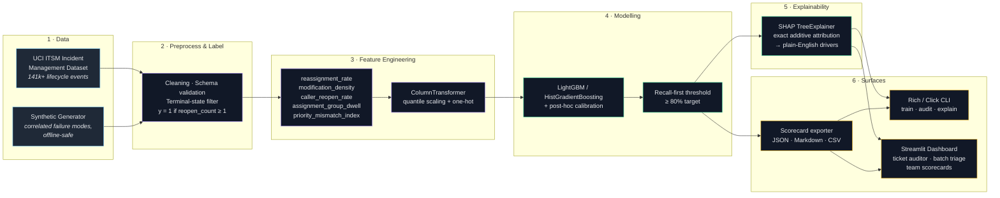
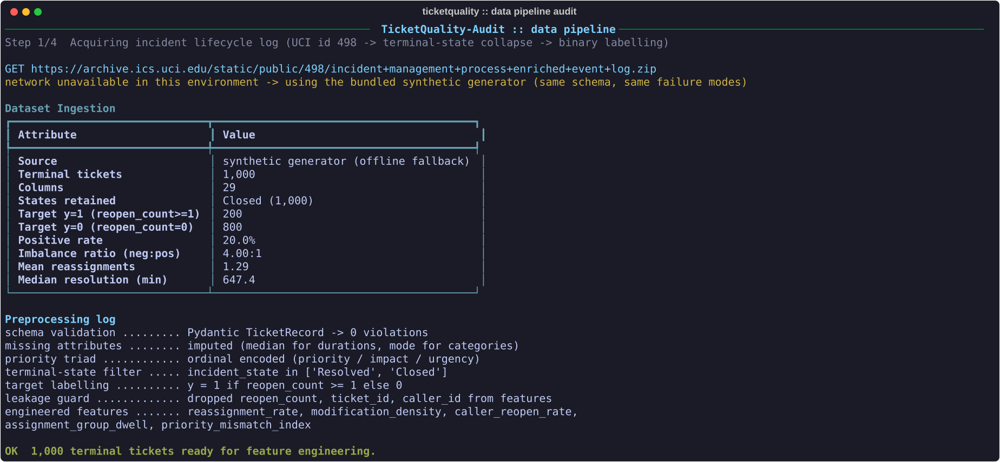
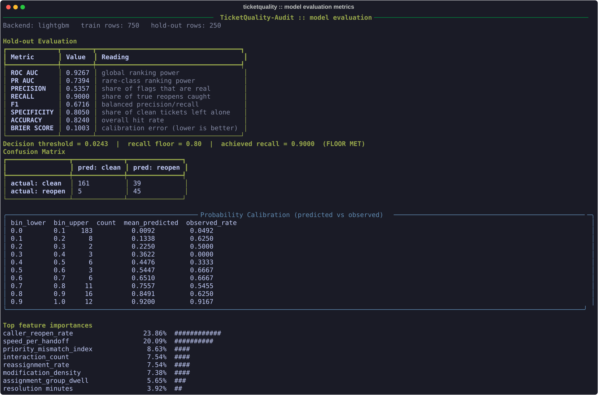
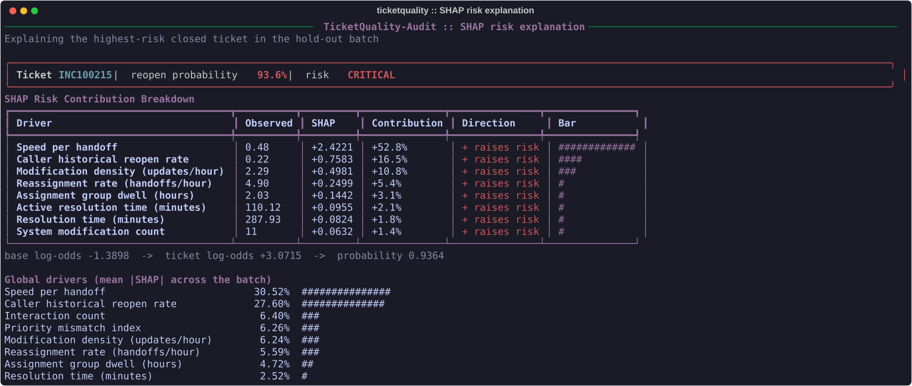
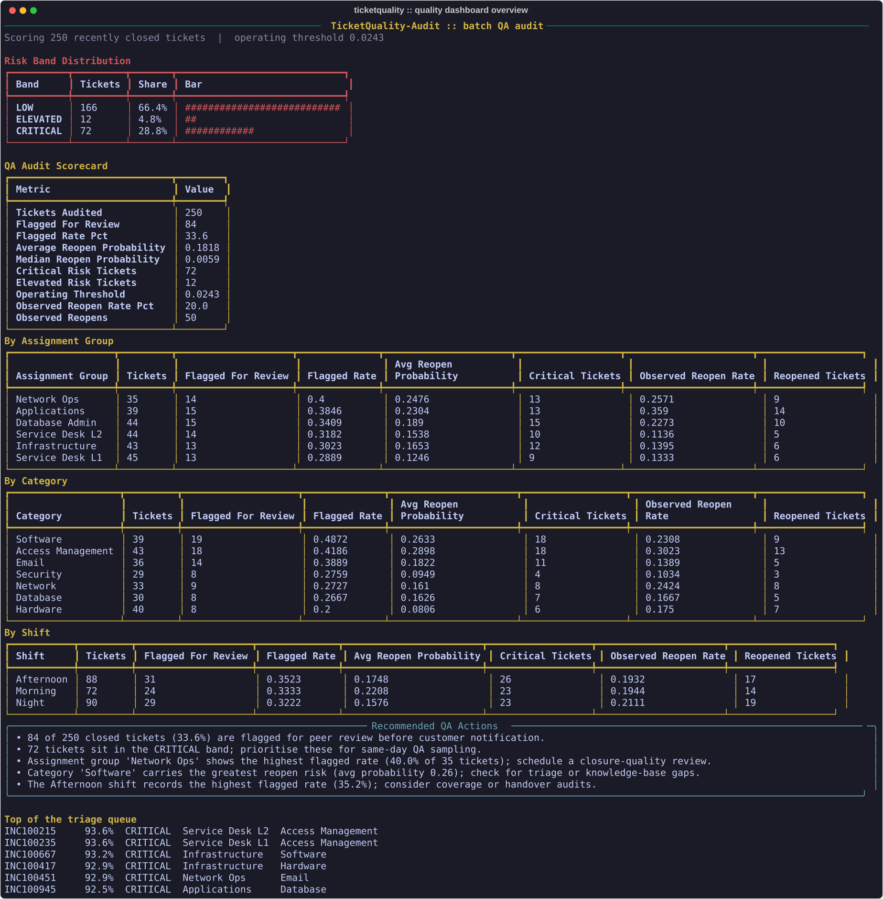

<div align="center">

# TicketQuality-Audit

**Premature Closure & Re-Open Risk Forecaster for Software Support**

*An audit engine that catches the tickets your support desk closed too early — before your customers do.*

[](.gitlab-ci.yml)
[](pyproject.toml)
[](pyproject.toml)
[](LICENSE)
[](Dockerfile)
[](https://github.com/microsoft/LightGBM)
[](https://github.com/shap/shap)
[](src/ticketquality/dashboard/app.py)

</div>

---

## Why this exists

Every support organisation reports the same two numbers: **mean time to resolve** and **tickets closed per day**. Both are trivially gamed by closing a ticket before it is actually fixed. The metric improves, the dashboard turns green, and three days later the customer reopens the incident — angrier than before, and now with a second ticket attached.

This is **premature closure**, and it is expensive in a way that never shows up on the operations dashboard:

- **Resolution metrics stop being trustworthy.** If 20% of closures bounce back, your MTTR figure is measuring how fast agents can clear a queue, not how fast problems get solved.
- **Customer trust erodes quietly.** A reopen is a customer discovering that your "resolved" notification was wrong. The damage is to confidence, not to the SLA clock.
- **QA is reactive and sampled.** Manual ticket audits catch a handful of cases a week. The failures that matter are the ones nobody sampled.

TicketQuality-Audit reframes the problem. Instead of auditing a sample of closures, it **scores every closure** for the probability that it will be reopened, explains *why* in language a support agent can act on, and hands QA leads a ranked queue of the closures that most deserve a second look.

The model is deliberately tuned for **high recall**. Missing a genuine premature closure costs a customer relationship; a false alarm costs a two-minute peer review. That roughly ten-to-one asymmetry is baked into the decision threshold.

---

## Architecture



**Pipeline in one line:** `ITSM data / synthetic stream → preprocessing & target labelling → feature engineering → LightGBM model → SHAP explainer → Streamlit UI & Rich CLI`

---

## What the model learns

Support quality is not a function of *how long* a ticket took — it is a function of **how the resolution was conducted**. A ticket closed in four minutes after three reassignments is a very different object from one closed in four minutes with a single clean touch, yet both look identical to a naive "resolution time" model.

The feature engine derives the operational-velocity signals that separate those cases:

| Feature | Definition | Why it matters |
| --- | --- | --- |
| `reassignment_rate` | Handoffs per active resolution hour | High values mean the ticket ping-ponged between queues |
| `modification_density` | `sys_mod_count` per lifecycle hour | Churn and last-minute edits — a sign of an unstable fix |
| `caller_reopen_rate` | Caller's historical tendency to contest closures | Fitted on the training split only; a genuine prior, not a leak |
| `assignment_group_dwell` | Hours parked in intermediate triage queues | Where the ticket spent its life before resolution |
| `priority_mismatch_index` | \|impact rank − urgency rank\| | The classic signature of a mis-triaged ticket |
| `combined_failure_mode` | Quick close × handoff intensity | The single strongest reopen signal in real support data |

Two engineering details worth calling out:

- **Leakage guard.** `reopen_count` defines the target, so it (along with identifiers and timestamps) is hard-blocked from the design matrix by `FORBIDDEN_FEATURES`. A config edit cannot silently reintroduce target leakage.
- **Out-of-fold threshold selection.** The decision threshold is chosen from cross-validated predictions with the *entire* stack refit per fold — fitting the pipeline once and reusing it would leak the per-caller reopen prior into the validation fold and flatter the threshold estimate.

---

## Screenshots

**Data pipeline audit** — ingestion, class balance and preprocessing logs.



**Model evaluation** — ROC-AUC, PR-AUC, calibration and the tuned threshold.



**SHAP risk explanation** — why one specific ticket was flagged.



**Batch QA scorecard** — risk distribution, team breakdowns and recommended actions.



> Every SVG above is generated by `scripts/generate_screenshots.py`, which runs the real pipeline and renders through the same Rich helpers the CLI uses — the documentation cannot drift from actual behaviour.

---

## Quickstart

```bash
# 1. Install (editable, with dev extras)
pip install -e ".[dev]"

# 2. Generate a synthetic audit dataset (no network required)
python scripts/generate_audit_dataset.py --samples 1000

# 3. Train and validate the classifier
ticketquality train --data data/synthetic_tickets.csv

# 4. Batch-audit a file of closed tickets
ticketquality audit --file examples/sample_tickets.csv

# 5. Launch the visual-management dashboard
streamlit run src/ticketquality/dashboard/app.py
```

The dashboard opens at <http://localhost:8501> with three tabs: **Single Ticket Auditor**, **Batch QA Uploader**, and **Team Quality Metrics**.

### Typical output

```
Backend: lightgbm  |  LightGBM available: True  |  train rows: 750

                     Hold-out Evaluation
┏━━━━━━━━━━━━━┳━━━━━━━━┳━━━━━━━━━━━━━━━━━━━━━━━━━━━━━━━━━━━━━┓
┃ Metric      ┃  Value ┃ Reading                             ┃
┡━━━━━━━━━━━━━╇━━━━━━━━╇━━━━━━━━━━━━━━━━━━━━━━━━━━━━━━━━━━━━━┩
│ ROC AUC     │ 0.9267 │ global ranking power                │
│ PR AUC      │ 0.7394 │ rare-class ranking power            │
│ PRECISION   │ 0.5357 │ share of flags that are real        │
│ RECALL      │ 0.9000 │ share of true reopens caught        │
│ F1          │ 0.6716 │ balanced precision/recall           │
│ SPECIFICITY │ 0.8050 │ share of clean tickets left alone   │
│ ACCURACY    │ 0.8240 │ overall hit rate                    │
│ BRIER SCORE │ 0.1003 │ calibration error (lower is better) │
└─────────────┴────────┴─────────────────────────────────────┘
Decision threshold = 0.0243  |  recall floor = 0.80  |  achieved recall = 0.9000 (FLOOR MET)
```

*Figures are from a representative run on 1,000 synthetic tickets (seed 42). Precision at a 90%-recall operating point is intentionally modest — that is the cost of catching nine in ten premature closures.*

---

## Data acquisition

### Option A — the real thing (UCI)

The primary source is the [UCI Machine Learning Repository **Incident Management Process Enriched Event Log**](https://archive.ics.uci.edu/dataset/498/incident+management+process+enriched+event+log) (dataset id 498) — a real event log of 141k+ incident lifecycle transitions.

```bash
# Download, extract, collapse the event log to terminal tickets, and label
python scripts/download_uci_dataset.py --output data/uci_incidents.csv

# or via the CLI (same code path)
ticketquality download --output data/uci_incidents.csv
```

The loader parses the multi-state lifecycle log, collapses it to one row per ticket, filters for terminal states (`incident_state in ['Resolved', 'Closed']`), and derives the binary target:

$$
y = \begin{cases}
1 & \text{if } reopen\_count \ge 1 \\
0 & \text{if } reopen\_count = 0
\end{cases}
$$

### Option B — synthetic (no network)

If the download is unavailable, the pipeline degrades gracefully to a built-in generator that reproduces the *statistical shape* of a real support desk — skewed resolution durations, a ~20% reopen rate, and the correlated failure modes QA leads actually look for (a quick close paired with heavy reassignment markedly raises reopen probability).

```bash
python scripts/generate_audit_dataset.py --samples 1000 --seed 42
```

Both paths emit the same schema, so every downstream command works identically against either source.

---

## Command reference

| Command | Purpose |
| --- | --- |
| `ticketquality train --data <csv>` | Train + validate; prints metrics, threshold and calibration |
| `ticketquality audit --file <csv> --output report.json` | Batch inference → audit scorecard (JSON or Markdown) |
| `ticketquality explain --ticket-id <id>` | ASCII SHAP contribution breakdown for one ticket |
| `ticketquality generate --samples N` | Write a synthetic audit dataset |
| `ticketquality download` | Fetch and prepare the UCI ITSM dataset |
| `ticketquality info` | Show resolved configuration and environment |

Useful flags: `--explanations` on `audit` includes SHAP cards for the top risks; `--queue queue.csv` writes the ranked triage queue; `--model <path>` pins a specific artefact.

---

## Docker

```bash
# Dashboard on http://localhost:8501
docker compose up

# Run CLI commands against the same image
docker compose run --rm cli train --data data/synthetic_tickets.csv
docker compose run --rm cli audit --file examples/sample_tickets.csv --output artifacts/report.json

# One-shot training profile
docker compose --profile train up trainer
```

The image is a two-stage build (`builder` → `runtime`), runs as a non-root user, installs `libgomp1` explicitly for LightGBM's native library, and warms up a trained model at build time so the container is immediately useful.

---

## Project layout

```
ticketquality-audit/
├── config/              # config.yaml (master) + model_params.yaml (hyper-parameters)
├── docs/screenshots/    # generated dark-mode terminal SVGs
├── scripts/             # dataset generation, UCI download, screenshots, git history
├── src/ticketquality/
│   ├── data/            # loader · synthetic · preprocessor
│   ├── features/        # engineer (velocity metrics) · transformers (sklearn pipeline)
│   ├── models/          # classifier · evaluation · explainer (SHAP)
│   ├── reports/         # scorecard · exporter
│   ├── dashboard/       # Streamlit app + components
│   └── cli.py           # Rich/Click entry point
├── tests/               # pytest suite (>88% coverage gate)
└── examples/            # sample_tickets.csv · sample_audit_report.json
```

---

## Development

```bash
pip install -e ".[dev]"

# Full suite with the coverage gate
pytest --cov=src/ticketquality --cov-report=term-missing

# Lint and format
ruff check src tests scripts
black --check src tests scripts

# Regenerate the documentation screenshots
python scripts/generate_screenshots.py

# Rebuild the demo commit history (19–30 Sep 2026)
FRESH=1 bash scripts/setup_git_history.sh
```

### Design notes

- **LightGBM with a transparent fallback.** `backend: auto` prefers LightGBM and falls back to scikit-learn's `HistGradientBoostingClassifier` when the native library cannot load — same algorithmic family, no crash on minimal environments.
- **Post-hoc calibration, not a wrapper.** Calibration (isotonic or Platt) is applied as a final monotonic layer rather than wrapping the booster in `CalibratedClassifierCV`. This keeps a *single* tree ensemble, so SHAP attributions remain exact and attributable.
- **Risk bands follow the threshold.** `LOW` / `ELEVATED` / `CRITICAL` boundaries default to the tuned operating threshold rather than hard-coded constants, so the "flagged for review" line and the start of the `ELEVATED` band can never disagree.

---

## License

Released under the [MIT License](LICENSE).

**Author:** Vinothkumar N · vinothofficial14@gmail.com
